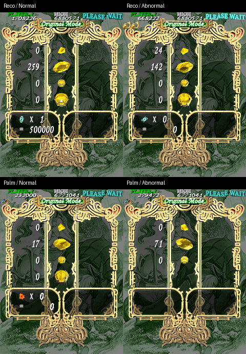
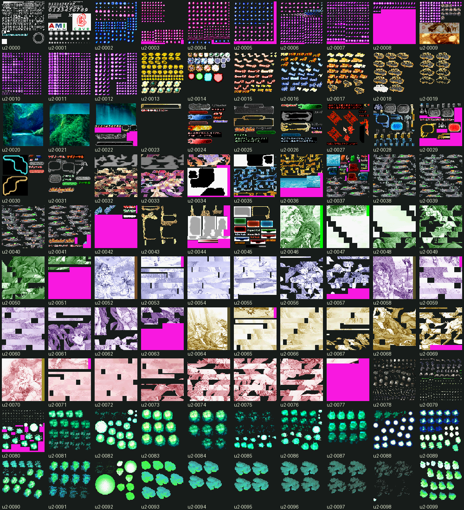
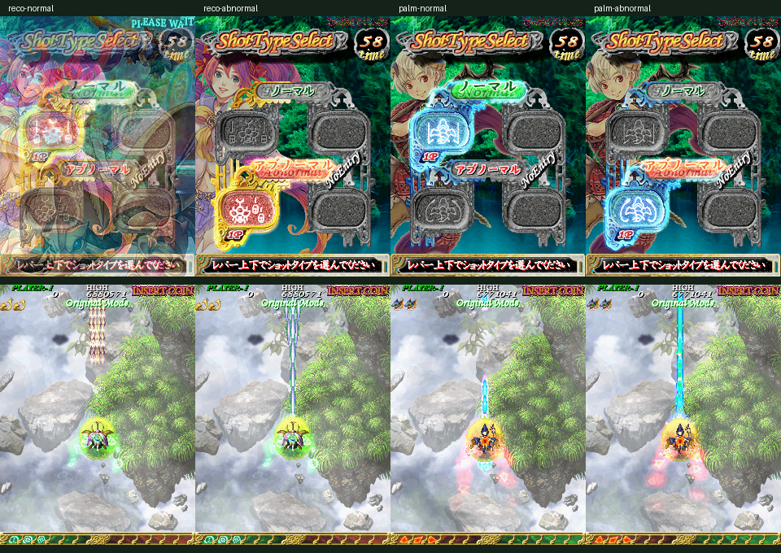

# Mushihimesama Futari reconstruction

Reverse engineering of **Mushihimesama Futari 1.5**, set `futari15`, revision
**2006/12/8 MAST VER. 1.54**. The first native target is the complete menu flow
and stage one in **Original mode**, with **Reco and Palm, Normal and Abnormal**.

**The first native milestone is playable on Apple Silicon macOS.** Menus and
stage one in Original mode run as ahead-of-time compiled ARM64 game code, with
native graphics, resource loading, cabinet input, audio and an AppKit frontend.
All four character/shot combinations have defeated the first boss, shown results
and entered stage two in headless native runs with ordinary damage and paid
continues. The app contains no MAME runtime, CPU interpreter or JIT.

This is a native recompilation, not a completed readable-source decompilation.
The [architecture](docs/NATIVE_ARCHITECTURE.md) keeps Futari's game adapter
separate from the shared ESP Ra.De controls and presentation boundary for future
combinations. Reference comparisons remain strictly headless.

## Native macOS app

Build locally using your verified ROM and Xcode Command Line Tools:

```sh
python3 tools/build_native_app.py --rom /path/to/futari15.zip
open 'build/macos/Mushihimesama Futari.app'
```

The build generates C++ from the original program, compiles it ahead of time,
and packages a signed ARM64 application. The generated code and game resources
stay local under ignored `build/`. The app can be moved after building. Operator
settings are stored separately in `~/Library/Application Support/Mushi/Native`.
Power-on checks run quickly; menus and gameplay use the board's frame rate.
Use the original operator menu's **Save & Exit** to commit configuration changes.

| Action | Keys |
| --- | --- |
| Move / select | Arrows or WASD |
| Shot / laser / confirm | J |
| Full auto | K or X |
| Bomb | L |
| Insert credit | Backslash |
| Start / continue | Return |
| Pause | Space |
| Native menu | Tab |
| Return to title / attract | Escape |
| Restart selected run | R |
| Mute | M |
| Filtering | P |
| Hold camera zoom | Z |
| Fullscreen | Control–Command–F or native menu |

Restart restores the selected run's stage-entry state, including audio and
random state. Operator settings are available from the native menu. The original
operator switch requires a two-second hold; the frontend supplies it automatically.
The former `Futari 1.5 Reference.app` is a separate historical comparison tool.
Use **Mushihimesama Futari.app** for native play.

A bundled startup check runs without creating a window or audio device:

```sh
'build/macos/Mushihimesama Futari.app/Contents/MacOS/Futari' --diagnose
```

The recorded native stage-clear routes can be reproduced without a window,
audio device, or emulator:

```sh
python3 tools/verify_native_playthroughs.py --route all
```



## Asset catalog

[Browse the asset catalog online](https://coldnightwarmth.github.io/mushi/).

[Download the offline asset catalog](https://github.com/coldnightwarmth/mushi/releases/download/v0.1.0/futari15-asset-catalog.zip),
extract it, and open `futari15-asset-catalog/index.html`. It works without a server.

The catalog includes:

- **1,201 / 1,201 directory-listed bitmap sheets**, all decoded, with transparent
  PNGs, upright previews, contact sheets, exact NAND byte spans, hashes and JSON.
- **3,965 observed drawing regions**, cropped using original blitter commands
  and byte-exact matches to the source sheets. Search by Reco, Palm, shot type,
  resource ID, or dimensions. Downloads preserve source orientation.
- **569 source sheets matched byte for byte to live graphics memory**, across
  21 reference captures. Each captured visible framebuffer also matches its
  reference screenshot exactly.

The sheet inventory is exhaustive for the NAND resource directory. The semantic
sprite catalog is **unfinished**: source regions include text, background tiles,
effects and partial assemblies; these counts do not mean 3,965 independent
characters or complete animation frames. Family names, multipart composition,
animation order, timing and complete gameplay reachability remain to recover.
Coverage and unmapped draws are recorded explicitly in the downloadable manifest.



## What is implemented

- Exact ROM revision verification with size, CRC32, SHA-1 and SHA-256.
- NAND directory parsing, reads across multiple bad blocks, bounded decompression,
  ARGB1555 decoding, and the searchable catalog.
- A native C decompressor, checked against the original SH-3 routine at
  `0x0c002ac4` for **all 273 compressed streams / 38,602,880 output bytes**.
- Reference input replays, RAM/VRAM capture, source-page matching, command-list
  parsing, screenshot comparisons and an original-instruction test harness.
- Expanded-program import and explicitly unreviewed Ghidra analysis exports.
- An ahead-of-time native game build and Swift/AppKit frontend using the shared
  ESP Ra.De controls, including both characters and shot types.
- Native command-list rendering: 1,045 original-device cases and all 64 blend
  pairs match exactly across 33,554,432 pixels.
- Native arithmetic: 2,592 original-instruction cases pass; compiled input
  routines also match all 2,781 original-state comparisons.
- Native YMZ770C sequencing and AMM audio, with credited BSD-licensed codec code.
- Four 15,000-frame native route runs, stage-entry restart, title return,
  operator/game settings and persistent EEPROM.

ROM archives, program dumps, emulator binaries, Ghidra and Java are not included
in the source repository. The catalog release contains derived artwork and its
provenance; game artwork remains attributed to CAVE.

## Build the catalog

Python 3.9 or newer is required. Run from this repository:

```sh
python3 -m venv .venv
.venv/bin/python -m pip install --upgrade pip
.venv/bin/pip install -e .
.venv/bin/python -m mushi verify /path/to/futari15.zip
.venv/bin/python -m mushi catalog /path/to/futari15.zip
.venv/bin/python -m mushi validate
open build/catalog/index.html
```

This rebuilds all 1,201 source sheets. To add runtime-observed regions, make the
reference captures below and run `mushi observe`. Regenerating the base catalog
replaces its manifest; rerun `observe` afterward to restore observed regions.

GitHub Pages serves the generated catalog from the `gh-pages` branch at
<https://coldnightwarmth.github.io/mushi/>. To publish an updated local catalog
and the current `mushi/web` interface, run:

```sh
.venv/bin/python tools/publish_pages.py
```

The helper uses a temporary checkout, validates every image and metadata file,
checks JavaScript syntax, and pushes the generated site to `gh-pages`. GitHub
then builds and deploys it automatically. Repository Pages settings use
**Deploy from a branch → gh-pages → / (root)**. ROMs and native app builds stay
outside the published catalog.

## Historical macOS reference app

Supply a working macOS MAME binary with the `futari15` driver. The verified local
runtime was **MAME 0.286 arm64 with SDL3**. Later versions may change saved-device
layouts and timing, so capture compatibility must be checked before using them.

```sh
.venv/bin/python tools/build_reference_app.py \
  --mame /path/to/mame \
  --frameworks /path/to/frameworks \
  --rom /path/to/futari15.zip
open 'build/macos/Futari 1.5 Reference.app'
```

Building requires Xcode Command Line Tools (`swiftc` and the macOS signing tools).
For the verified SDL3 runtime, `--frameworks` names the folder containing
`SDL3.framework`; omit it when the builder can find that framework next to MAME
or in `/Library/Frameworks`.

The native launcher bundles your MAME runtime, SDL3 framework and ROM inside the
local app, so the whole app can be moved without rebuilding. Saves, settings and
the startup log live in `~/Library/Application Support/Mushi/Reference`. Existing
local settings are seeded at build time and do not overwrite later preferences.
The generated app includes your ROM and stays local; it is not a release artifact
or a native gameplay port. Missing runtime/data and save-folder failures show an
error dialog. To inspect resolved paths without starting the game, run:

```sh
'build/macos/Futari 1.5 Reference.app/Contents/MacOS/FutariReference' --diagnose
```

| Action | Keys |
| --- | --- |
| Insert credit | `5` or `\` |
| Start / join | Return or `1` |
| Move / select | Arrows or WASD |
| Shot / laser / confirm | J or Z |
| Bomb | L or X |
| Full auto | K or C |
| Reference pause | P |
| Reference settings | Tab |
| Exit | Escape |

Choose **Original**, then Reco or Palm, then Normal or Abnormal. The current
app runs original game instructions through MAME, including the later stages.
The verified native scope is menus and stage one; later stages are not claimed validated.



## Reproduce the reference evidence

```sh
.venv/bin/python tools/run_reference.py \
  --mame /path/to/mame --frameworks /path/to/frameworks \
  --rom /path/to/futari15.zip --capture build/reco-normal \
  --character reco --shot normal --frames 18000 \
  --snapshots 2800,3000,3150,3400,6000,9000,12000,15000,18000 \
  --autoplay --graphics --audio
```

The bot fires, bombs, inserts credits and pays for continues. It does not patch
game RAM or provide invulnerability. Frame numbers are local to each cold-boot
capture. Select `--character palm` and/or `--shot abnormal` for the other routes.
`--graphics` saves a 128 MiB VRAM image per snapshot; omit it when only testing
progression. Audio capture is separate from visual and memory verification.

```sh
.venv/bin/python -m mushi observe \
  build/reco-normal build/reco-abnormal build/palm-normal build/palm-abnormal
.venv/bin/python -m mushi validate
.venv/bin/python tools/package_catalog.py
```

## Validate native work

```sh
.venv/bin/python -m unittest discover -s tests -v
.venv/bin/python tools/verify_native.py /path/to/futari15.zip
.venv/bin/python tools/verify_original_decoder.py \
  --mame /path/to/mame --frameworks /path/to/frameworks \
  --rom /path/to/futari15.zip
```

The second command compiles the native C service with Clang on macOS and compares
all compressed streams with the bounded Python implementation. The third executes
the original decoder instructions in an isolated, interrupt-masked SH-3 context
and compares every output byte. These verify resource decoding, not gameplay.

See [current evidence](docs/STATUS.md), [recovered formats and addresses](docs/REVERSE_ENGINEERING.md),
[the native milestone checklist](docs/MILESTONE.md), and [source references](docs/SOURCES.md).
