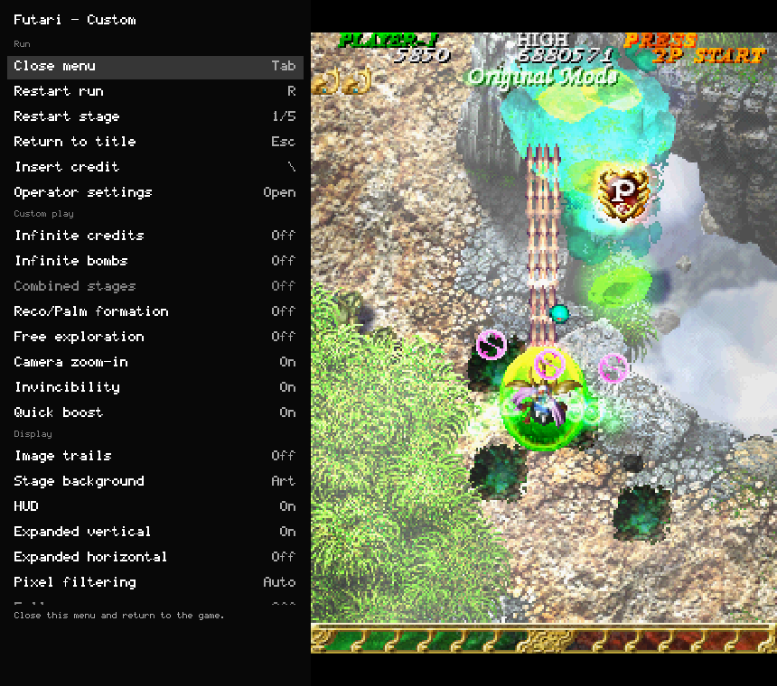
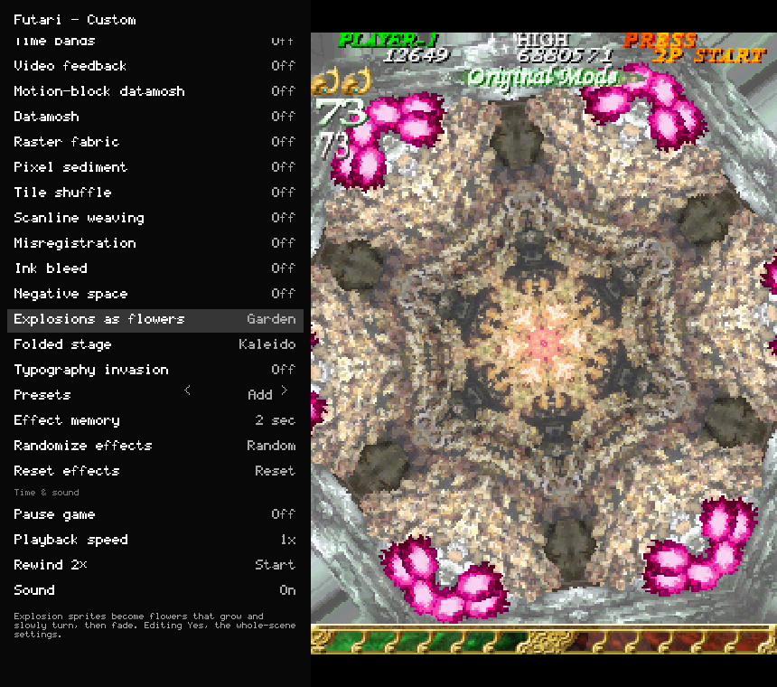

# Native custom menu

Press **Tab** in the 0.5.0 Mac build. The menu pauses the game, preserves an
existing pause, and clears held gameplay inputs. Use arrows/WASD to move,
Left/Right to change a value, and J/Return/Space to activate it. Mouse selection,
Shift-click to cycle backward, and scrolling also work. Tab or Escape closes it.
The sidebar keeps the game visible beside it when the window has enough room.

The menu vocabulary, bitmap font, art options, compression helpers and art engine
come from the user's ESP Ra.De. native project. They live in `native/shared/`;
Futari-specific inputs, scene layers and gameplay changes stay in its adapter.
No ESP Ra.De. ROM data or machine state is incorporated into this game.

| Group | Features |
| --- | --- |
| Run | Resume, restart run, restart stage, title, insert credit, original operator settings |
| Custom play | Infinite credits/bombs, combined stages, Reco/Palm formation, exploration, camera zoom, four protection modes, Shift boost |
| Display | Original scenery or ten solid colors, HUD, vertical/horizontal expansion, Auto/Sharp/Smooth filtering, fullscreen |
| Art | Ten trail styles; fifteen effect families / 45 variants; independent effect targets; saved presets; randomization; 1/2/4-second memory; reset |
| Time and sound | Pause, 0.25/0.5/1/2/4/10× speed, 2× rewind, mute |

Art effects are slit-scan, time bands, video feedback, motion-block datamosh,
predictive Datamosh (Melt/Bloom), raster fabric, pixel sediment, tile shuffle, scanline weaving, misregistration,
ink bleed, negative space, explosions as flowers, folded stage and typography
invasion. HUD and menu are drawn after these effects. Bkg affects scenery and visual FX while leaving live players and enemies clear. Typography uses Futari's own captured lettering and HUD art.

Trail styles are Off, Normal, Spaced, Sparse, Fade, Loop, Scale, Scale2x, Flash
and Random. Scaling uses individual connected sprite shapes. Random uses
observed variants with matching native draw families, atlas pages and geometry;
it does not change gameplay animation or substitute a damaged enemy's live
animation. This is a Futari adaptation of the ESP Ra.De. Random presentation.
Explosion/impact draw layers drive flowers, sediment and burst tile shuffling;
they are not a recovered enemy-death event API.






## Independent targets and saved presets

**Other effects** selects the bank to edit: Yes (whole scene), Bkg, Non-player,
Player or Enemies. Each bank retains its own variants and memory. They run
together: an enabled specific choice overrides the broader choice for that
effect. An Off variant inherits broader settings; selecting global Off pauses
all banks without erasing them. Image trails keep running, and each echo follows
its source's target group. HUD and menu remain outside these effects.

**Presets** offers Default, Add, and numbered saved looks. Left/Right or A/D
browse; J, Return, Space, or the center of the row applies or saves. Mouse arrows
browse without applying. Presets persist in
`~/Library/Application Support/Mushi/Native/Effect presets.plist` and include
all five banks, disabled choices, memory settings and trails. They do not change
game rules, sound, playback rate or the current run. Existing invalid files are
left intact and reported in the menu. ESP Ra.De.'s preset files remain separate.

**Randomize effects** randomizes the banks, their memory, image trails and the
selected editing bank. **Reset effects** restores all effect defaults and clears
visual history and trails; saved presets survive.

The new **Datamosh** has Melt and Bloom modes. It uses the same deterministic
predictive-video model as ESP Ra.De., retaining a damaged reference and applying
measured motion and signed residuals. The older four-mode filter is now labeled
**Motion-block datamosh**. Both participate in presets, scope banks and rewind.

Target ownership currently follows Futari's recovered draw queue and observed
priority bands. It is a presentation partition, not a claim of completed enemy
object or animation recovery. The native groups recombine to exact native pixels;
spatial effects preserve the live pixels of protected groups.

## Futari adaptations

- **Reco/Palm formation** joins the original second-player flow and mirrors the
  controls to the partner. Both original characters retain their native weapons,
  collision rules, bombs and lives. Return to title to remove a joined partner.
- **Infinite bombs** replaces ESP Ra.De.'s infinite special charge. Protection
  cycles Off, On, Infinite lives and Absorb; Absorb refills bombs on protected
  native collision contacts.
- **Combined stages** starts three independent native worlds at stages 1, 2 and
  3 and composites their scenery and actors. Each world retains its own enemies,
  collisions, resources and subsequent stage progression. Input is shared; the
  primary world's HUD and soundtrack are presented. Configure this before the
  run. **Endless** repeats the three opening stages independently.
- **Free exploration** holds native scenery and stage events while stationary.
  Up advances them; Down scrolls scenery backward. Existing enemies remain
  active, and backward travel does not respawn defeated enemies or undo events.
- **Expanded view** reveals the rendered native overscan: up to 304×384 upright
  pixels. Horizontal Open also extends player movement bounds. This is bounded
  native overscan, rather than the ESP Ra.De. port's reconstructed full map.

These choices preserve native Futari simulation behind `NativeGame.h`. Combining
weapons, enemies or character logic across the two different games remains
separate future work.

## Shortcuts

The existing arrows/WASD, J, K/X, L, Return and backslash controls are unchanged.
The custom shortcuts match the ESP Ra.De. host:

| Key | Action |
| --- | --- |
| Tab | Custom menu |
| Space | Pause/resume |
| Shift, held | 2.5× movement boost, when enabled |
| Z, held | Camera zoom, when enabled |
| Q, held | Rewind at 2× |
| E, held | Temporary 4× playback |
| I | Cycle protection mode |
| − / keypad − | Cycle background |
| + / = / keypad + | Toggle HUD |
| P / M | Filtering / mute |
| R / Escape | Restart run / title |
| Control–Command–F | Fullscreen |

Rewind stores changed RAM pages, changed graphics tiles, device state and audio
decoder state. Its budget is 192 MiB and at most 600 frames per world. Available
history therefore varies with the scene. Stage/run resets clear simulation
history. Display history has separate bounded storage and restores recorded
custom images while rewinding. Playback speed changes simulation timing and
resamples audio to the selected duration. Dense combinations of visual effects
and multiple worlds can cost more than a normal single-world frame.

## Headless verification

Build first, then run:

```sh
.venv/bin/python tools/verify_native_custom.py --output build/custom-verified
```

The C++ harness checks original behavior with custom options disabled, exact
RAM/VRAM/audio reverse-and-replay, gameplay options, both characters/shot types,
combined worlds, independent endless loops and a full custom campaign.
The app's `--verify-menu INPUTS OUTPUT` entry exercises synthetic keyboard events,
all menu actions, effect variants, trail styles, scopes, playback/audio duration,
rewind display, title/stage transitions and small/wide offscreen menu rendering.
It never opens a window, posts desktop input or starts an audio device.

Physical fullscreen, mouse/trackpad feel and speaker output are not exercised
by these headless checks. Results are recorded in
[evidence/native-custom-menu.json](evidence/native-custom-menu.json).
