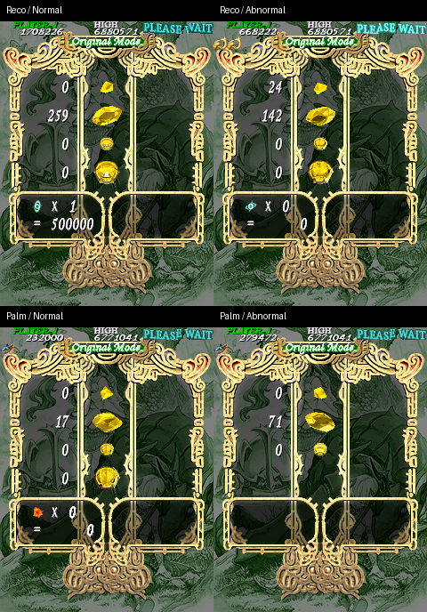
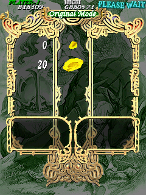

# Status — 2026-11-16

**Native menus and stage one are playable on Apple Silicon macOS.** The locally
built `Mushihimesama Futari.app` uses ahead-of-time compiled game functions,
native peripheral services and Swift/AppKit. It does not launch or link MAME,
interpret SH instructions, or compile code at runtime.

All four Original-mode routes completed 15,000 native frames using the existing
input replays, ordinary damage and paid continues. Each defeated the stage-one
boss, displayed results and entered stage two. Native progression evidence is
in [native-playthroughs.json](evidence/native-playthroughs.json).

| Native check | Result |
| --- | --- |
| Reco / Normal | Results at frame 10800; stage two at 11400 |
| Reco / Abnormal | Results at frame 11400; stage two at 12000 |
| Palm / Normal | Results at frame 10800; stage two at 11100 |
| Palm / Abnormal | Results at frame 10800; stage two at 11100 |
| Compiled arithmetic | 2,592 exact original-instruction comparisons |
| Compiled input / Swift input | 2,781 exact original-state comparisons each |
| Graphics | 1,045 draw cases, all 64 blend pairs, full VRAM byte exact |
| Restart | 90 frames of restored pixels and audio repeat exactly |
| Game over | Continue timeout, Game Over and return to attract exercised |
| Operator menu | Game configuration, Save & Exit, saved difficulty after relaunch |
| EEPROM | 256 words round-trip; repeated high-clock writes ignored |
| Bundle | Signed ARM64; macOS Launch Services ran 120 frames without a window/audio device |

Controls follow ESP Ra.De: arrows/WASD, J, K/X, L, Return and backslash; Space,
Tab, M, Escape, R, P and Z are frontend controls. The [architecture](NATIVE_ARCHITECTURE.md)
keeps the game adapter separate from the shared physical controls/presentation.

This milestone establishes playable native execution, not a finished readable
source recovery. Full-game cycle accuracy/slowdown equivalence and later stages
are unverified. The physical window/fullscreen interactions have not been
exercised on the user's active desktop. All reference comparisons force SDL's
dummy video/audio drivers and disable desktop input providers.
The installed bundle's identity and diagnostic result are recorded in
[native-bundle.json](evidence/native-bundle.json).

## Verified resource recovery

| Measure | Result |
| --- | ---: |
| Supplied ROM members verified | 4 / 4 |
| Directory-listed bitmap sheets decoded | 1,201 / 1,201 |
| Raw / compressed sheets | 929 / 272 |
| Decoded bitmap payload bytes | 157,441,492 |
| Unique bitmap payloads | 1,201 |
| Sheets matched exactly to original VRAM | 569 |
| Observed draw rectangles exported | 3,965 |
| Screenshot / framebuffer comparisons | 21, all exact |
| Verified animation sequences | 0 |
| Native decoder streams checked against original SH-3 | 273, all exact |
| Decoder output bytes compared | 38,602,880 |

See [coverage](evidence/catalog-coverage.json),
[drawing observations](evidence/graphics-observations.json),
[catalog validation](evidence/catalog-validation.json),
[native decoder results](evidence/native-decoder.json), and
[original-instruction results](evidence/original-decoder.json).

The 3,965 regions are distinct resource rectangles, not a unique-art or animation
count. Some are glyphs, background tiles, partial UI pieces or partial sprites.
Draws from dynamic/cross-page VRAM sources are retained as unmapped counts.

## Reference playthroughs

The input replays select Original mode and exercise all four choices. They use
normal input ports, ordinary deaths, bomb presses, inserted credits and paid
continues. No invulnerability, altered life bank, stage skip or other RAM cheat
is applied. MAME's existing CV1000 driver remains responsible for emulation.

| Route | Menu/shot evidence | Stage-one progression evidence |
| --- | --- | --- |
| Reco / Normal | `reco-normal`, frames 3000–3400 | Boss defeat at 10000–10400, results at 10800, stage-two scenery at 11400 in `stage-clear` |
| Reco / Abnormal | `reco-abnormal`, frames 3000–3400 | Boss defeat at 10200, clear transition at 10800, stage two at 11400 in `reco-abnormal-clear` |
| Palm / Normal | `palm-normal`, frames 2890–3400 | Results at 10800, stage two at 11400 in `palm-normal-clear` |
| Palm / Abnormal | `palm-abnormal`, frames 2890–3400 | Results at 10800, stage two at 11400 in `palm-abnormal-clear` |

The local capture directories include original screenshots, RAM snapshots, input
scripts, runtime arguments, exact ROM identities and frame logs. These large
artifacts stay under ignored `build/`; compact evidence and images accompany the
source. Detailed capture parameters are in [reference runs](evidence/reference-runs.json).

Reference audio was captured as 48 kHz, signed 16-bit mono: 14,394,241 samples,
12,378,466 nonzero samples, peak absolute amplitude 15,388. This verifies that
the reference produces audio; listening quality and native audio equivalence are
not established by these numerical checks.

## Checks and limits

- Ten targeted format tests pass: overlapping references, flag boundaries,
  malformed streams, bad-block spanning, bounds, colors, word swapping and
  command lengths.
- Clang builds the native decoder with `-Wall -Wextra -Werror`; all compressed
  resources and the program match Python and the isolated original decoder.
- Every exported PNG and metadata link exists. Every observed-region PNG exactly
  equals its recorded crop of the source sheet.
- The original shell launcher passed a command-line smoke test but failed when
  opened normally: macOS denied the shell's access to the Documents folder before
  it could write its log. The replacement is a native Swift/Mach-O entry point,
  with MAME, SDL3 and the user's ROM bundled locally and writable state in
  Application Support. Normal Launch Services startup now opens the game window;
  bundle signature verification and path diagnostics also pass.
  It explicitly selects SDL audio: this MAME build's default CoreAudio backend
  hung during shutdown on this Mac, while SDL audio completed the same test.
- The browser automation connection was unavailable in this session. Catalog
  images/contact sheets and source data were inspected, and JavaScript syntax
  checked; interactive browser layout and keyboard behavior need a live UI pass.
- Automatic decompiler output remains unreviewed. It is never counted as native
  implementation coverage.

Next readable-source work: replace generated game functions with reviewed
services while preserving native replay behavior; recover semantic sprite
assemblies, object identities, animation order and timing.
