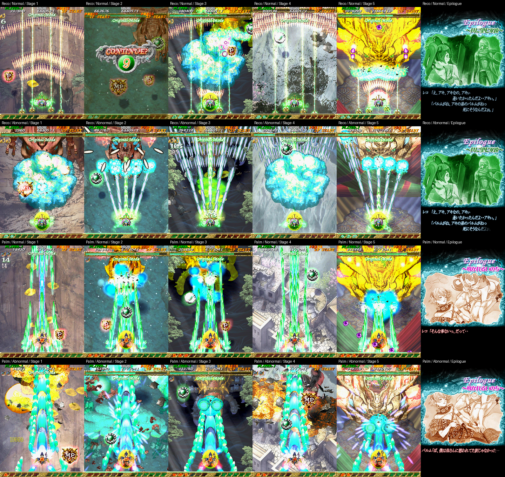
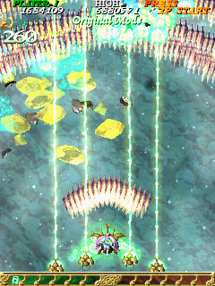

# Status — 2026-11-21

**Native menus and all five Original-mode stages are playable on Apple Silicon
macOS.** The signed 0.4.0 app uses ahead-of-time compiled game code, native
peripheral services and Swift/AppKit. It has no MAME runtime, CPU interpreter,
or runtime compiler.

All four character/shot routes completed the entire campaign using ordinary
damage and paid continues, followed by the unskipped epilogue, ranking and return
to attract. The full runs total **360,048 native frames**. Each stage also passed
a 90-frame restart comparison of both pixels and audio: **20 checks**.
See [native-campaigns.json](evidence/native-campaigns.json).

| Native check | Result |
| --- | --- |
| Reco / Normal | All five stages; ending at 82511; attract at 90239 |
| Reco / Abnormal | All five stages; ending at 84410; attract at 92129 |
| Palm / Normal | All five stages; ending at 80729; attract at 87977 |
| Palm / Abnormal | All five stages; ending at 82465; attract at 89699 |
| Compiled arithmetic | 2,592 exact original-instruction comparisons |
| Compiled input / Swift input | 2,781 exact original-state comparisons each |
| Graphics | 1,045 draw cases, all 64 blend pairs, full VRAM byte exact |
| Restart stage | All 20 stage/character/shot combinations reproduce graphics and audio |
| Game over | Continue timeout, Game Over and return to attract exercised |
| Operator menu | Game configuration, Save & Exit, changed difficulty after relaunch |
| EEPROM | 256 words round-trip; repeated high-clock writes ignored |
| Bundle | Signed ARM64; headless macOS launch diagnostic |

Controls follow ESP Ra.De. R / Restart game starts the selected run over from
stage one. Tab → Restart stage restores the current stage. The menu shows the
current stage, and the public game adapter exposes named campaign phases and
completion state without leaking RAM addresses into the frontend.

This establishes full Original-mode native playability, not completed readable
source recovery. Hardware cycle/slowdown equivalence and other modes remain
unverified. Physical window/fullscreen interaction was not exercised on the
active desktop. All work in this milestone was headless; no MAME process was
needed for the full-game runs. Bundle identity is in
[native-bundle.json](evidence/native-bundle.json).

## Custom menu

The 0.4.0 build adds the ESP Ra.De. custom menu, adapted to Futari: 43 actions,
all 43 art-effect variants, ten trail styles, Reco/Palm formation, combined and
endless stages, exploration, infinite bombs/credits, protection modes, expanded
view, playback speeds and rewind. Shared art code and game-specific simulation
remain separated for future combinations.

The [menu guide](CUSTOM_MENU.md) explains the adaptations and shortcuts.
[Custom-menu evidence](evidence/native-custom-menu.json) records native and
offscreen checks. The original four complete ordinary-damage campaign baselines
above remain separate from custom-option stress runs.

## Verified resource recovery

| Measure | Result |
| --- | ---: |
| Supplied ROM members verified | 4 / 4 |
| Directory-listed bitmap sheets decoded | 1,201 / 1,201 |
| Raw / compressed sheets | 929 / 272 |
| Decoded bitmap payload bytes | 157,441,492 |
| Unique bitmap payloads | 1,201 |
| Sheets matched exactly to original VRAM | 569 |
| Sheets matched exactly to native source pages | 1,091 |
| Observed draw rectangles exported | 64,458 |
| Native stage coverage | All five stages, four routes |
| Screenshot / framebuffer comparisons | 21, all exact |
| Verified animation sequences | 0 |
| Native decoder streams checked against original SH-3 | 273, all exact |
| Decoder output bytes compared | 38,602,880 |

See [coverage](evidence/catalog-coverage.json),
[drawing observations](evidence/graphics-observations.json),
[catalog validation](evidence/catalog-validation.json),
[native decoder results](evidence/native-decoder.json), and
[original-instruction results](evidence/original-decoder.json).

The 64,458 regions are distinct resource rectangles, not a unique-art or animation
count. Many are cropped glyphs, background strips, partial UI pieces or partial sprites.
The browser supports stage filtering and uses a compact index; complete evidence
is retained in per-region JSON and the downloadable compressed manifest.
Draws from dynamic/cross-page VRAM sources are retained as unmapped counts.

## Reference playthroughs

The input replays select Original mode and exercise all four choices. They use
normal input ports, ordinary deaths, bomb presses, inserted credits and paid
continues. No invulnerability, altered life bank, stage skip or other RAM cheat
is applied. MAME's existing CV1000 driver remains responsible for emulation.

| Route | Menu/shot evidence | Stage-one progression evidence |
| --- | --- | --- |
| Reco / Normal | `reco-normal`, frames 3000–3400 | Boss defeat at 10000–10400, results at 10800, stage-two scenery at 11400 in `stage-clear` |
| Reco / Abnormal | `reco-abnormal`, frames 3000–3400 | Boss defeat at 10200, clear transition at 10800, stage two at 11400 in `reco-abnormal-clear` |
| Palm / Normal | `palm-normal`, frames 2890–3400 | Results at 10800, stage two at 11400 in `palm-normal-clear` |
| Palm / Abnormal | `palm-abnormal`, frames 2890–3400 | Results at 10800, stage two at 11400 in `palm-abnormal-clear` |

The local capture directories include original screenshots, RAM snapshots, input
scripts, runtime arguments, exact ROM identities and frame logs. These large
artifacts stay under ignored `build/`; compact evidence and images accompany the
source. Detailed capture parameters are in [reference runs](evidence/reference-runs.json).

Reference audio was captured as 48 kHz, signed 16-bit mono: 14,394,241 samples,
12,378,466 nonzero samples, peak absolute amplitude 15,388. This verifies that
the reference produces audio; listening quality and native audio equivalence are
not established by these numerical checks.

## Checks and limits

- Ten targeted format tests pass: overlapping references, flag boundaries,
  malformed streams, bad-block spanning, bounds, colors, word swapping and
  command lengths.
- Clang builds the native decoder with `-Wall -Wextra -Werror`; all compressed
  resources and the program match Python and the isolated original decoder.
- Every exported PNG and metadata link exists. Every observed-region PNG exactly
  equals its recorded crop of the source sheet.
- The installed 0.4.0 bundle passes code-signature verification and a Launch
  Services diagnostic that executes 120 native frames without opening a window
  or audio device. Resources are bundled locally and writable settings use
  Application Support. The earlier MAME launcher has been replaced entirely.
- A hidden-browser pass verified resource/region switching, stage filtering,
  combined stage/text searching and region detail provenance. Stage five has
  339 matched sheets and 16,524 observed regions. The complete browser index also
  matches the full extraction manifest. Keyboard-only navigation and physical
  game-window/fullscreen interaction remain untested.
- Automatic decompiler output remains unreviewed. It is never counted as native
  implementation coverage.

Next readable-source work: replace generated game functions with reviewed
services while preserving native replay behavior; recover semantic sprite
assemblies, object identities, animation order and timing.
